<div align="center">

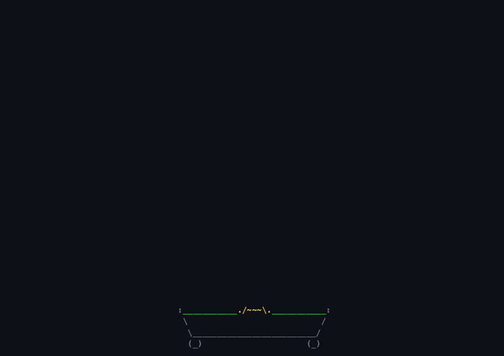

# oxiper

### Animated terminal wallpapers, oxidized.

**cbonsai · asciiquarium · neo · nyancat · aafire**, ported faithfully to Rust,<br>
plus sixteen more scenes. One small binary. Nearly no CPU. Your terminal's transparency stays intact.

[](https://github.com/donutinit/oxiper/actions/workflows/ci.yml)
[](LICENSE)
[](https://www.rust-lang.org)


[Gallery](#gallery) ·
[Install](#install) ·
[Usage](#usage) ·
[Screensaver](#screensaver-mode) ·
[Customize](#make-it-yours) ·
[Aquarium](#the-aquarium) ·
[Día de Muertos](#día-de-muertos) ·
[Transparency](#transparency) ·
[Performance](#performance) ·
[Scene options](#scene-options)

</div>

---

## Why oxiper

- **The classics, for real.** The bonsai is cbonsai's growth engine, call for call. It even uses
  glibc's `rand()`, so `-o bonsai.seed=42` grows *exactly* the tree `cbonsai -s 42` grows. The aquarium
  carries all 95 sprites of asciiquarium, verified glyph by glyph against Term::Animation, with
  sharks that eat fish and hooks that catch them, and then grows into seven biomes with
  **281 kinds of fish** and hundreds more creatures, plants, props and passers-by, all reacting
  to each other. The rain is neo's droplet model, falling at neo's real speed. Nyan Cat flies with
  the original twelve frames.
- **One binary, twenty-one scenes.** Mix them into a playlist and give each one its own theme, pace and
  time on screen. And now and then, when you least expect it, a train, a duck or Nyan Cat goes by.
- **Fiestas.** On Mexican holidays every scene dresses up. On Día de Muertos the dog becomes a
  xoloitzcuintle walking a path of marigolds to an ofrenda, the bonsai a tree of life, the DVD logo
  a sugar skull, the aurora moves to Lake Pátzcuaro, and papel picado hangs over everything. See
  [Día de Muertos](#día-de-muertos).
- **Transparency first.** oxiper never paints a background it doesn't have to, so blurred or
  translucent terminals stay see-through. It even asks your terminal what its background looks like,
  so fading trails fade *into it*.
- **A real customization engine.** A commented TOML config that reloads live while oxiper runs,
  23 themes including one that reads your terminal's own palette and one that reads pywal,
  your own themes, options for every scene, and `-o key=value` on the command line for all of it.
- **A screensaver for your shell.** One line in `.bashrc`, `.zshrc` or `config.fish` and it starts
  after the prompt sits idle, then hands your half-typed command back untouched. It works inside
  tmux too.
- **Built to be left running.** No terminal library: raw termios, `poll(2)` and a diffing renderer
  that only sends the cells that changed. Scenes tell the loop when their picture will change next,
  so a grown bonsai costs **0.0 %** CPU.

## Gallery

<table>
<tr>
<td align="center" width="50%">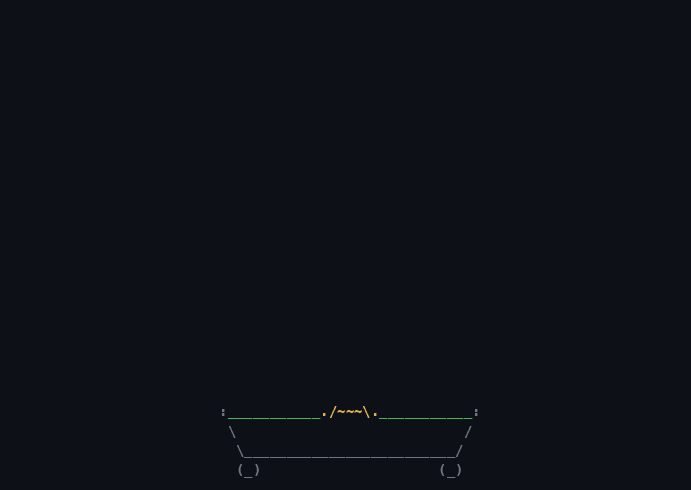<br><b>bonsai</b> · after <a href="https://gitlab.com/jallbrit/cbonsai">cbonsai</a><br><sub><code>oxiper -s bonsai</code></sub></td>
<td align="center" width="50%">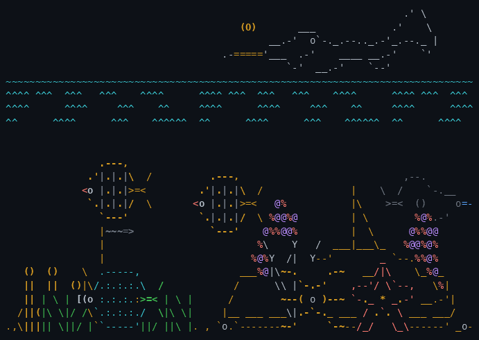<br><b>aquarium</b> · after <a href="https://robobunny.com/projects/asciiquarium/html/">asciiquarium</a><br><sub><code>oxiper -s aquarium -o aquarium.biome=reef</code></sub></td>
</tr>
<tr>
<td align="center">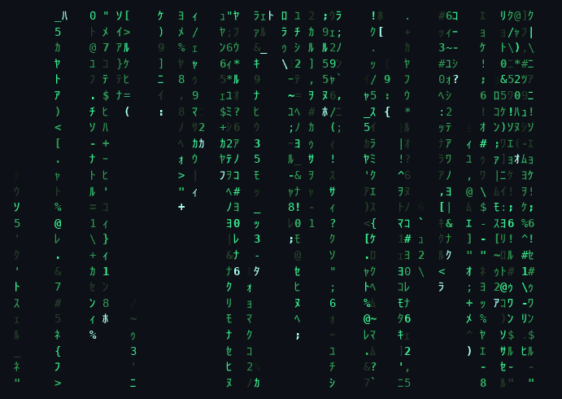<br><b>neo</b> · after <a href="https://github.com/st3w/neo">neo</a><br><sub><code>oxiper -s neo</code></sub></td>
<td align="center">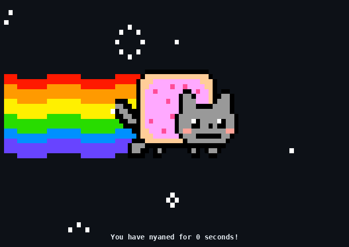<br><b>nyancat</b> · after <a href="https://github.com/klange/nyancat">nyancat</a><br><sub><code>oxiper -s nyancat</code></sub></td>
</tr>
<tr>
<td align="center">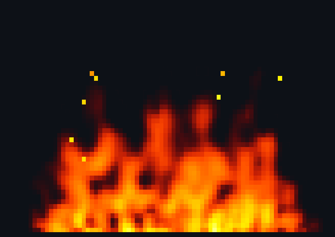<br><b>fire</b> · after aalib's <code>aafire</code><br><sub><code>oxiper -s fire</code></sub></td>
<td align="center">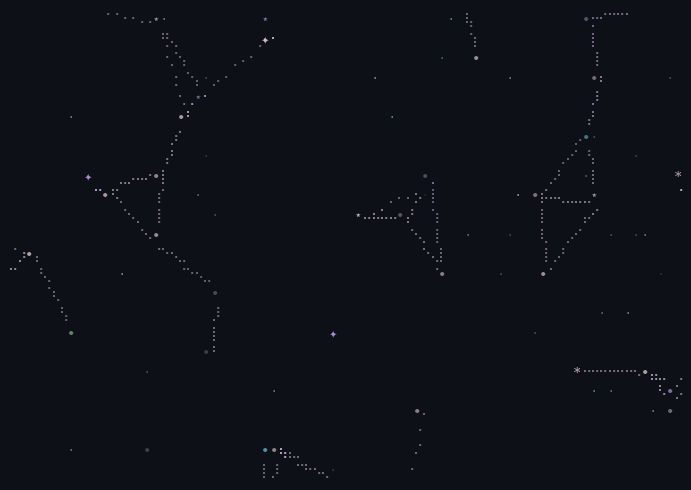<br><b>constellation</b> · drifting stars that link up<br><sub><code>oxiper -s constellation -t catppuccin</code></sub></td>
</tr>
<tr>
<td align="center">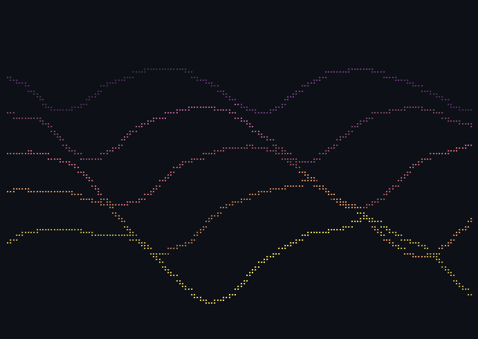<br><b>waveform</b> · layered rolling waves<br><sub><code>oxiper -s waveform -t synthwave</code></sub></td>
<td align="center">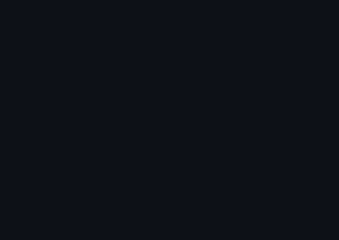<br><b>pipes</b> · after <a href="https://github.com/pipeseroni/pipes.sh">pipes.sh</a><br><sub><code>oxiper -s pipes</code></sub></td>
</tr>
<tr>
<td align="center">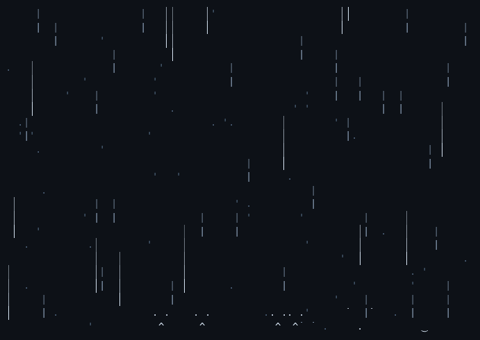<br><b>rain</b> · depth, wind, splashes, lightning<br><sub><code>oxiper -s rain</code></sub></td>
<td align="center">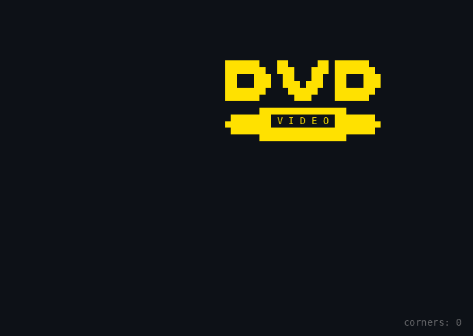<br><b>dvd</b> · will it hit the corner?<br><sub><code>oxiper -s dvd</code></sub></td>
</tr>
<tr>
<td align="center">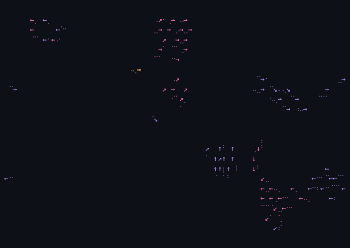<br><b>boids</b> · flocking, with a hawk<br><sub><code>oxiper -s boids -t dracula</code></sub></td>
<td align="center">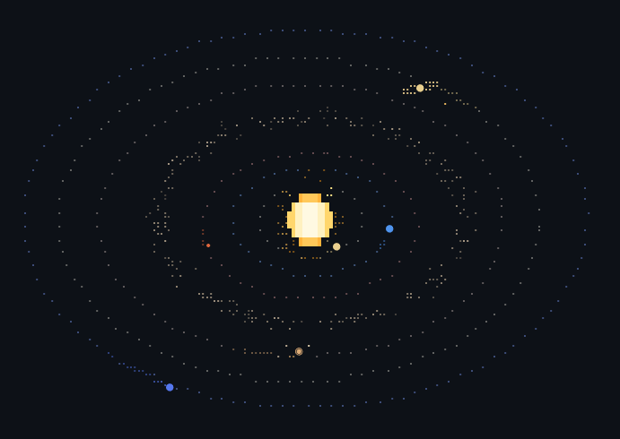<br><b>orrery</b> · Kepler orbits, moons, rings<br><sub><code>oxiper -s orrery</code></sub></td>
</tr>
<tr>
<td align="center">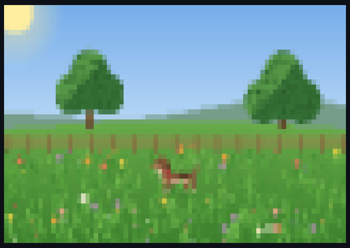<br><b>dog</b> · after <a href="https://github.com/SantiagoSchez/tanim">tanim</a><br><sub><code>oxiper -s dog</code></sub></td>
<td align="center">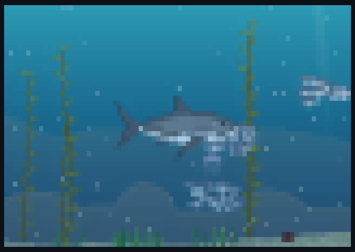<br><b>shark</b> · four species, day and night<br><sub><code>oxiper -s shark</code></sub></td>
</tr>
<tr>
<td align="center" colspan="2">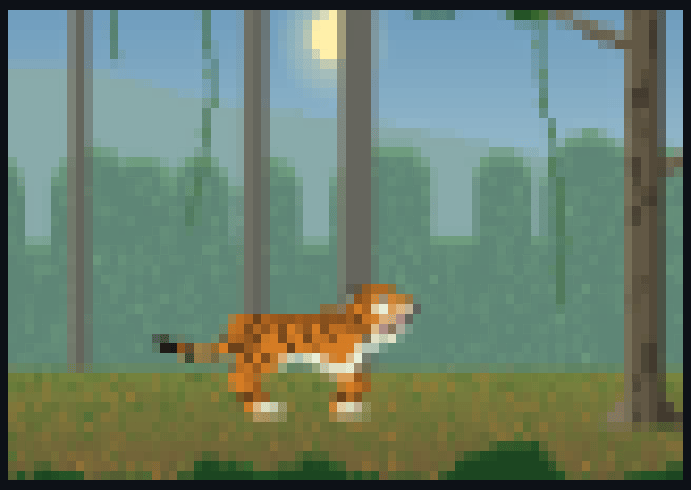<br><b>tiger</b> · an immortal apex predator, until the saucer comes<br><sub><code>oxiper -s tiger</code></sub></td>
</tr>
<tr>
<td align="center">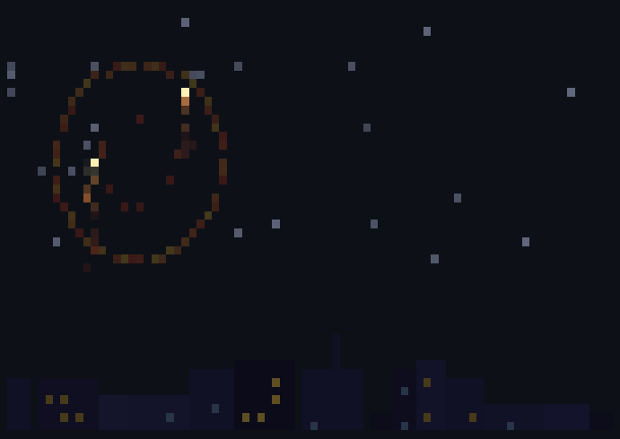<br><b>fireworks</b> · after <a href="https://github.com/SantiagoSchez/tanim">tanim</a><br><sub><code>oxiper -s fireworks</code></sub></td>
<td align="center">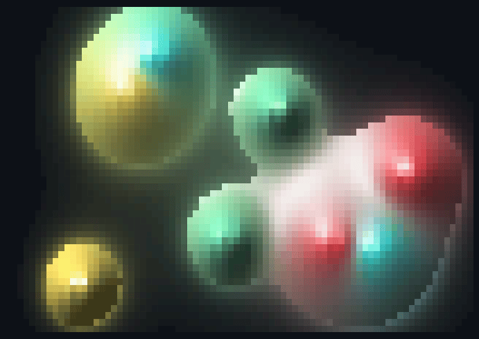<br><b>metaballs</b> · after <a href="https://github.com/SantiagoSchez/tanim">tanim</a><br><sub><code>oxiper -s metaballs -t synthwave</code></sub></td>
</tr>
<tr>
<td align="center">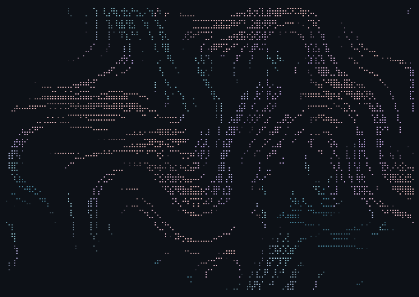<br><b>particles</b> · a flow field, or fireworks<br><sub><code>oxiper -s particles -t rosepine</code></sub></td>
<td align="center">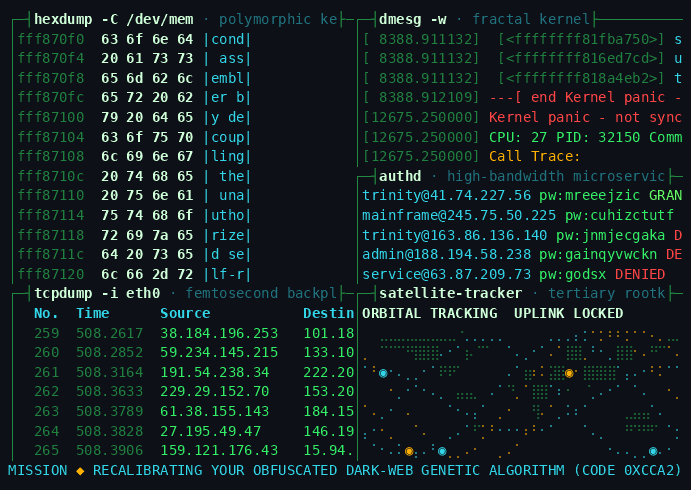<br><b>hollywood</b> · after <a href="https://github.com/dustinkirkland/hollywood">hollywood</a><br><sub><code>oxiper -s hollywood</code></sub></td>
</tr>
<tr>
<td align="center">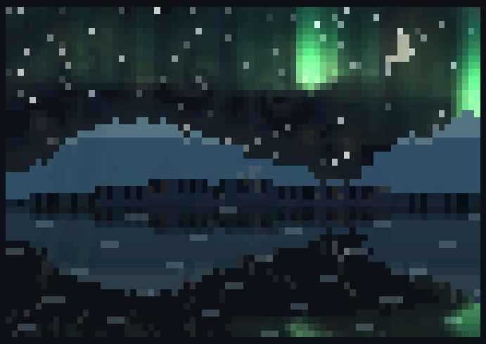<br><b>aurora</b> · after <a href="https://github.com/SantiagoSchez/tanim">tanim</a>, nine looks, one of them Van Gogh's<br><sub><code>oxiper -s aurora</code></sub></td>
<td align="center">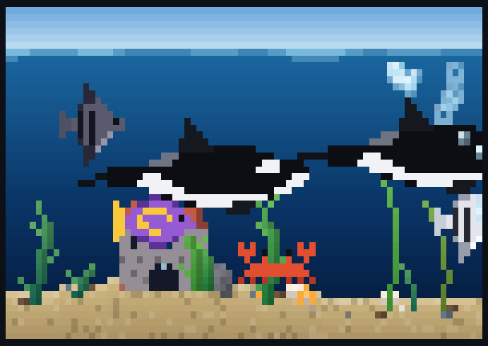<br><b>ocean</b> · tanim's tank with orcas, dolphins and mantas<br><sub><code>oxiper -s ocean</code></sub></td>
</tr>
<tr>
<td align="center" colspan="2">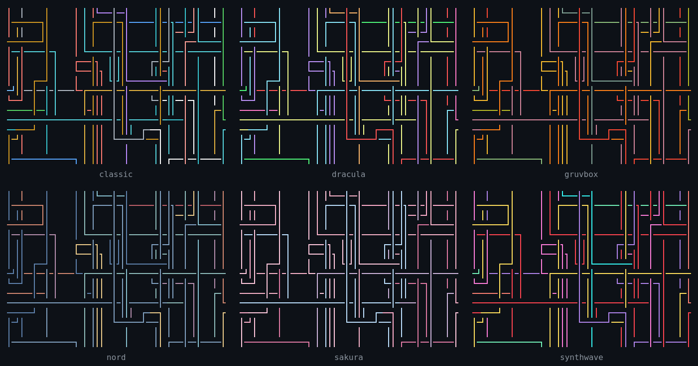<br><b>23 themes</b> · or follow your terminal's palette<br><sub><code>oxiper list themes</code></sub></td>
</tr>
</table>

<sub>Every animation above was recorded by oxiper itself (<code>oxiper record</code>) and rendered with <a href="https://github.com/asciinema/agg">agg</a>; see <a href="scripts/gifs.sh"><code>scripts/gifs.sh</code></a>.</sub>

## Install

**With Cargo** (a recent stable Rust):

```sh
cargo install --git https://github.com/donutinit/oxiper
```

**Prebuilt binaries** for Linux (static, x86_64 and aarch64) and macOS (Intel and Apple Silicon)
are on the [releases page](https://github.com/donutinit/oxiper/releases). Unpack and put `oxiper`
anywhere on your `PATH`.

**From source:**

```sh
git clone https://github.com/donutinit/oxiper && cd oxiper
cargo build --release   # → target/release/oxiper
```

Runs on Linux and macOS in any terminal that speaks ANSI; the idle screensaver integration is
Linux-only for now. Truecolor terminals look best, and 256-color, 16-color and no-color
terminals work too (`NO_COLOR` is honored).

## Usage

```sh
oxiper                         # every scene, a minute each
oxiper -s bonsai               # just one
oxiper -s neo,fire,aquarium -d 30 --shuffle
oxiper -s neo -t synthwave     # any scene, any theme
oxiper -s bonsai -o bonsai.life=60 -o bonsai.leaves='&,*,@'
oxiper -s pipes -o pipes.style=rounded -o fps=60
oxiper list                    # scenes          · oxiper list themes
oxiper list options neo        # what you can tune
```

| key | action | key | action |
|:-:|---|:-:|---|
| <kbd>←</kbd> <kbd>→</kbd> | previous / next scene | <kbd>space</kbd> | pause |
| <kbd>↑</kbd> <kbd>↓</kbd> | next / previous theme | <kbd>+</kbd> <kbd>-</kbd> <kbd>0</kbd> | faster / slower / normal |
| <kbd>r</kbd> | reseed the scene | <kbd>?</kbd> | help overlay |
| <kbd>q</kbd> <kbd>esc</kbd> | quit | | (in `--saver` mode any key quits) |

Leave it running in a spare tmux pane or a borderless terminal on your desktop: that's the
*wallpaper* in oxiper. When the window loses focus it drops to `unfocused_fps` (10 by default,
0 pauses completely).

## Screensaver mode

Add one line to your shell's startup file:

```sh
eval "$(oxiper shell-init bash)"   # ~/.bashrc
eval "$(oxiper shell-init zsh)"    # ~/.zshrc
oxiper shell-init fish | source    # ~/.config/fish/config.fish
```

After `idle` seconds without typing at the prompt (120 by default), oxiper takes over the screen.
Press any key and you're back at your prompt with whatever you'd half-typed still there; the key
you pressed is swallowed, not typed. It never interrupts a running program: vim, builds and `less`
are safe.

<details>
<summary>How it works</summary>

`shell-init` starts one tiny watcher per shell that sleeps almost all the time. It checks the
terminal's access time (the kernel updates it whenever the shell reads a keystroke) and whether
the shell owns the terminal's foreground.

- **zsh and fish** can run signal handlers while you type, so the watcher sends them `SIGUSR1` and
  they start `oxiper --saver` themselves.
- **bash** can't, so the watcher pauses the shell, borrows the terminal, runs the saver and hands
  everything back.
- **bash inside tmux** gets a full-screen tmux popup instead, because tmux would wake a paused
  shell on its own.

The watcher exits when its shell does. Set the delay with `idle` under `[saver]` in the config,
or `OXIPER_IDLE=60` before the `shell-init` line.
</details>

The `[saver]` section of the config can override anything for screensaver runs, e.g. shuffle all
scenes 30 seconds each:

```toml
[saver]
idle = 300
scene = "all"
shuffle = true
duration = 30.0
```

## Make it yours

```sh
oxiper config init     # writes ~/.config/oxiper/config.toml, every setting documented
oxiper config check    # catches typos and bad values
```

The config reloads **live**: save the file and the running oxiper picks it up. A taste:

```toml
scene = ["bonsai", "aquarium", "neo", "constellation"]
duration = 90.0
theme = "rosepine"
fps = 30
background = "transparent"     # or "theme", or "#0b0e14"

[scenes.bonsai]
theme = "classic"              # every scene can have its own theme…
life = 48
leaves = "&,*,❀"
message = "breathe"

[scenes.neo]
theme = "matrix"
pace = 1.4                     # …its own pace…
duration = 30.0                # …and its own time on screen
charset = "katakana+digits"
glitch_pct = 15.0

[scenes.constellation]
link_distance = 14.0

[themes.midnight]              # your own theme, built on top of another
inherit = "tokyonight"
ramp = ["#0b1021", "#1f3b73", "#4f7cff", "#a9c1ff"]   # dark → bright, for gradients
colors = ["#4f7cff", "#ff6ac1", "#5af78e", "#f3f99d"] # accents
```

Anything in the file can also be set for a single run: `-o theme=nord`, `-o neo.density=2`,
`-o saver.idle=60`.

Speed (`speed`, a scene's `pace`, `--speed`, the `+` and `-` keys) only changes how fast things
move. Clocks keep real time: at a tenth of the speed the aquarium still moves to another biome
every five minutes and its day still lasts fifteen, a finished bonsai still waits its `wait`, and
Nyan Cat's counter still counts real seconds.

### Themes

`classic` keeps every scene in the colors of the program it pays homage to (the ports use your
terminal's own ANSI palette, exactly like the originals). The rest:

| | |
|---|---|
| **follow your setup** | `terminal` (asks your terminal for its 16 colors, so gradients stay smooth) · `wal` (reads [pywal](https://github.com/dylanaraps/pywal)) |
| **popular schemes** | `catppuccin` · `dracula` · `gruvbox` · `nord` · `rosepine` · `tokyonight` · `kanagawa` · `everforest` · `solarized` · `onedark` · `monokai` |
| **moods** | `synthwave` · `vaporwave` · `matrix` · `amber` · `ember` · `ocean` · `forest` · `sakura` · `mono` |

`oxiper list themes` shows swatches. Press <kbd>↑</kbd>/<kbd>↓</kbd> while it runs to flip through them.

## Easter eggs

Every so often (about once an hour, never in the first minute) something crosses the screen over
whatever scene is playing, then leaves on its own within 30 seconds:

- **sl**: the steam locomotive you get for mistyping `ls`, at sl's own pace. Usually the D51,
  sometimes the little one or the C51, and once in a while sl's `-a` accident, with people
  shouting for help.
- **duckpond**: the duck from [duckpond.sh](https://github.com/gsobell/duckpond.sh) paddles
  along a line of water, quacking.
- **nyancat**: Nyan Cat flies across with its rainbow, the frames and palette of the nyancat
  scene, over whatever is below.

They are not scenes, so they never show up in a playlist. Make them rarer, more frequent, or
turn them off:

```toml
eggs = "all"          # "none", or a list like "sl"
egg_rate = 1.2        # per hour of playing time; 0 = never
```

Can't wait? Press <kbd>E</kbd>.

During [Día de Muertos](#día-de-muertos) five more join them, and come far more often: La
Catrina, a swarm of monarchs, an alebrije, skeleton mariachis and a *calaverita literaria*.

The aurora sends its own: Nyan Cat or sl's train crosses its sky about three times an hour
(`aurora.visitors`), whatever these settings say.

## Día de Muertos

From October 28 to November 3 every scene dresses up for Día de Muertos, and the holiday builds
up the way an ofrenda does: the first petals on the 28th, the little ones (the angelitos) on the
31st and November 1, everyone and everything on November 2, and on the 3rd the souls go back.

<p align="center">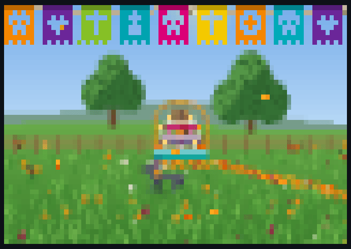</p>

oxiper follows your local date; try it any day, or turn it off:

```sh
oxiper -o fiestas=muertos          # the holiday at its height
oxiper -o fiestas=muertos@10-28    # or one of its days
```

```toml
fiestas = "auto"   # "none", "muertos", or "muertos@MM-DD"
```

Over every scene, papel picado hangs across the top (two strings from November 1) and
cempasúchil petals drift down. Seasonal visitors cross far more often than the everyday eggs:
La Catrina strolling with her bouquet, a swarm of monarchs, a winged jaguar alebrije, three
skeleton mariachis, and a *calaverita literaria*, a rhymed verse in which La Muerte comes for one
of oxiper's own characters, typing itself out in a corner.

And each scene has its own:

- **bonsai** grows as a Metepec *árbol de la vida*: cempasúchil, terciopelo and nube among the
  leaves, a talavera pot, a sugar skull and veladoras at its foot, more of the ofrenda each day.
- **aquarium** sets an ofrenda on the sea floor, in asciiquarium's ASCII: a path of petals the
  souls walk down at night, candles floating on the waves, calavera fish and alebrijes.
- **neo** rains cempasúchil and rosa mexicano, hides words in the rain (DÍA DE MUERTOS, MICTLÁN,
  CEMPASÚCHIL) and now and then paints a calavera out of its own glyphs.
- **nyancat** wears a sugar-skull face on a pan de muerto, trails papel picado, and the counter
  reads "¡Llevas N segundos nyaneando!".
- **dog** is a xoloitzcuintle with a marigold collar, walking a path of petals to an ofrenda under
  a marigold arch; by night small souls follow it home.
- **shark** wears calavera face paint over sunken ofrendas, with plankton glowing like embers.
- **tiger** becomes an Oaxacan alebrije and bows its head at an ofrenda in the ruins, under papel
  picado strung from tree to tree; the saucer that comes for it is a sugar skull.
- **ocean** is Janitzio's night on the water: veladoras on rafts of marigolds, alebrije fish, and
  orcas and sharks in calavera paint.
- **fire** is a field of veladoras in painted glass, aafire's flames rising from every wick, with
  marigolds and copal smoke.
- **fireworks** turns the city into a panteón with candles on the graves; shells burst into
  calaveras, marigolds and petals.
- **aurora** moves to Lake Pátzcuaro: Janitzio with candles on its terraces, butterfly-net canoes
  and monarchs crossing the sky (`look = "patzcuaro"` any day).
- **constellation** gathers its stars into a calavera, La Catrina, a marigold, a monarch or a
  veladora, then lets them go.
- **waveform** strings its waves into garlands of petals, with veladoras burning on the crests and
  sugar skulls riding along.
- **pipes** become garlands of papel picado with marigolds opening at the joints.
- **rain** brings marigold petals with the drops, veladoras along the ground, and lightning that
  catches the dead dancing in the dark.
- **dvd** bounces a sugar skull crowned with marigolds; at a corner, "¡Ya se lo llevó la Catrina!".
- **boids** become monarchs migrating home to Michoacán, souls in candle-gold among them, with La
  Catrina in place of the hawk.
- **orrery** has a folk-art sun-calavera that winks, planets in marigold garlands and a belt of
  petals.
- **particles** carry cempasúchil blossoms and monarchs down a river of morado, rosa and turquesa.
- **metaballs** melt colored veladora wax under flickering flames, with sugar-skull candles among
  them.
- **hollywood** goes Mictlán: a radar tracking souls on their way home, an ofrenda database, a
  gateway through the nine levels, face recognition that turns the living away ("TODAVÍA NO TE
  TOCA"), and technobabble in Spanish.

Under other themes the holiday takes the theme's colors, keeping only candle flames and
marigolds their own. On any other day every scene is exactly as it always was.

## The aquarium

`biome = "classic"` is asciiquarium, exactly. Every other setting goes further, in asciiquarium's
own drawing style: seven biomes with **281 fish**, 93 other creatures, 85 plants and corals,
69 props and 84 passers-by, and they all notice each other.

<p align="center">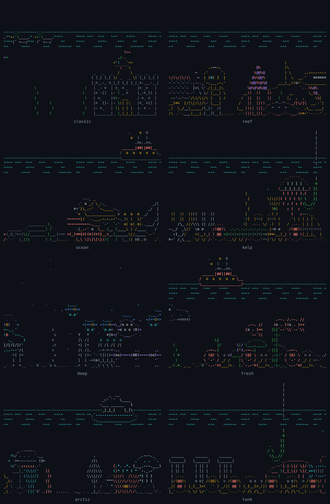</p>

- **Seven places.** Coral reef, open ocean, kelp forest, the deep sea, rivers and lakes, polar seas
  and a home tank, each with its own fish, plants, floor props and visitors. The deep sea has no
  surface: marine snow drifts down instead, and anglerfish light their lures.
- **Alive in different ways.** Fish swim in schools that keep formation. Others cruise straight,
  rise and sink, dart in bursts, drift like jellyfish or hover like seahorses, and crabs, lobsters,
  starfish and snails walk the sand, stopping now and then.
- **Everything reacts to everything.** Sharks, barracudas and pike hunt smaller fish, and schools
  scatter and regroup. Shy fish duck behind corals and wrecks, octopuses squirt ink, pufferfish
  puff up, and jellyfish and lionfish sting whoever brushes them. Clownfish keep to their
  anemones and morays to their caves. Remoras ride along with whale sharks, groupers and sea lions
  come over to look at divers, and grazers nibble the plants. Pelicans and gannets plunge in for a
  fish, trawlers drag nets, anglers lower a line, orcas take a bite, crabs clean up the scraps, and
  the seaweed sways as fish push through it.
- **Day, night and weather.** A sun crosses the sky. At night the water dims, the stars come out,
  nocturnal fish appear and lanternfish and comb jellies glow. A current bends the plants and
  carries the bubbles, storms roll in now and then with rain and lightning, and dim creatures swim
  far back behind the plants.
- **Something special now and then.** Feeding time in the tank, a plankton bloom that brings a
  whale shark, a ball of sardines swirling until the predators arrive, a long migration, a pod of
  orcas, and very rarely a legend: a coelacanth, a giant squid, a mermaid.
- **Día de Muertos.** During the holiday an ofrenda stands on the sea floor with a path of petals
  that the souls walk down at night, veladoras float on rafts of marigolds, and calavera fish,
  alebrijes, a catrina jellyfish, the xolo and La Catrina rowing a trajinera join in, more each day
  (`season = "muertos"` brings them any day). See [Día de Muertos](#día-de-muertos).
- **Never the same twice.** Each creature takes its colors from its species' palette, so no two
  clownfish match. The sea starts in a random biome and moves on every five minutes. The floor
  changes at once, and the creatures already swimming finish their crossing.
- **asciiquarium's cast stays.** The shark still eats fish and the hook still catches them. The
  ship, whale, sea monster, ducks, swan and dolphins pass by alongside submarines, divers, orcas,
  pirate ships, seagulls and the occasional UFO.
- **Clear or painted water.** By default the water is your terminal's own background, so a
  translucent terminal stays see-through. `water = "deep"` paints the sea instead: a gradient
  from bright to dark, slow shafts of light and sandy dunes, after the aquarium in
  [tanim](https://github.com/SantiagoSchez/tanim).

```toml
[scenes.aquarium]
biome = "reef,kelp,deep"           # move between these; "mixed" puts everything together
biome_time = 600                   # seconds in each place
species = "-krill-swarm"           # leave some out, or name the only ones you want
decor = "sunken-galleon,treasure-chest"
visitors = "-ufo"
day_length = 1800                  # a slower day; 0 keeps it day
events = 2                         # something special twice as often
interactions = false               # everyone minds their own business
water = "deep"                     # paint the sea instead of showing your background
```

`oxiper list species` names every fish, critter, plant, prop and visitor, and the biomes each one
belongs to.

## Transparency

Most terminal toys paint every cell black, which turns a blurred, translucent terminal into a
flat rectangle. oxiper is built the other way around:

- Empty cells are drawn with the terminal's **default** background (`SGR 49`), so whatever your
  terminal shows through (wallpaper, blur, opacity) keeps showing through.
- Pixel-art scenes (fire, nyan cat) use half blocks. A cell with only one lit half sets just a
  foreground color, so the other half stays transparent.
- Trails don't fade "to black". At start-up oxiper asks the terminal for its real background
  color (`OSC 11`) and fades toward that, so trails dissolve into your background, light or dark.
  Override it with `bg_hint`.
- `strict_transparency = true` goes all the way: no background color is ever emitted, not even
  inside two-colored half blocks.
- Prefer a solid backdrop? `background = "theme"` or `background = "#101018"`.

## Performance

oxiper is meant to run all day, so the frame loop is careful:

- **Diffing renderer.** Each frame is compared to the last one and only changed cells are sent,
  with the shortest cursor moves and only the color/attribute parameters that differ.
- **Synchronized updates** (DEC mode 2026): terminals that support them never show half a frame.
- **Sleeps when nothing changes.** Scenes report when their picture changes next, so a finished
  bonsai or a 90 ms nyancat frame doesn't burn the frames in between.
- **No terminal library.** Raw termios, `poll(2)`, a small escape parser and `SIGWINCH`: nothing
  between oxiper and the TTY, and a closed terminal is noticed at once.
- **No allocation per frame** in the renderer or in the scenes; 256-step gradient tables are
  precomputed in OKLab.

CPU and memory against the originals, each in a 120×40 tmux pane for 15 s
(Linux 7.2, Fedora 44; oxiper at its default 30 fps):

| scene | original | oxiper |
|---|---|---|
| bonsai (live, infinite) | cbonsai: 0.1 % · 3.3 MB | **0.07 %** · 3.9 MB |
| aquarium | asciiquarium: 7.1 % · 11.7 MB | **1.2 %** · 7.0 MB |
| neo | neo: 2.3 % · 5.6 MB | **1.3 %** · 3.9 MB |
| nyancat | nyancat: 0.3 % · 1.9 MB | **0.27 %** · 4.1 MB |

Per-frame cost of every scene at 200×60 (`oxiper bench`, release build):

| scene | simulate + draw (µs) | diff + encode (µs) | bytes / frame | cells changed |
|---|--:|--:|--:|--:|
| bonsai | 6 | 71 | 22 | 0.0% |
| aquarium | 22 | 81 | 1278 | 1.6% |
| neo | 56 | 125 | 4154 | 1.6% |
| nyancat | 62 | 112 | 1942 | 2.4% |
| dog | 415 | 330 | 22318 | 8.3% |
| shark | 431 | 426 | 54179 | 17.8% |
| tiger | 287 | 327 | 25534 | 9.0% |
| ocean | 184 | 253 | 12385 | 3.7% |
| fire | 137 | 428 | 159136 | 48.6% |
| fireworks | 188 | 117 | 8712 | 2.8% |
| aurora | 587 | 329 | 81651 | 21.4% |
| constellation | 155 | 144 | 20705 | 7.8% |
| waveform | 112 | 115 | 11271 | 7.2% |
| pipes | 45 | 158 | 253 | 0.1% |
| rain | 21 | 140 | 25643 | 12.7% |
| dvd | 5 | 73 | 398 | 0.4% |
| boids | 280 | 114 | 8375 | 3.6% |
| orrery | 81 | 125 | 7942 | 3.1% |
| particles | 421 | 393 | 109235 | 42.4% |
| metaballs | 415 | 542 | 194936 | 50.9% |
| hollywood | 45 | 114 | 5742 | 11.1% |

<sub>Intel i7-9700KF, one core. Even the busiest scenes stay under 1 ms per frame at 30 fps, i.e. under 3 % of one core.</sub>

## Scene options

Every option goes under `[scenes.<name>]` in the config, or on the command line as
`-o <name>.<option>=<value>`. Every scene also accepts `theme`, `pace` (a time multiplier) and
`duration`, which override the global settings while that scene plays.

<details>
<summary><b>bonsai</b> — a bonsai tree grows branch by branch, after cbonsai</summary>

Aliases: `cbonsai`

| option | default | |
|---|---|---|
| `life` | `32` | Life; higher -> more growth, 0-200 (cbonsai -L) |
| `multiplier` | `5` | Branch multiplier; higher -> more branching, 1-20 (-M) |
| `base` | `1` | Pot to grow in: 1 or 2, 0 for none (-b) |
| `leaves` | `"&"` | Comma-separated strings chosen at random for leaves (-c) |
| `message` | `""` | Message shown in a box next to the tree, empty for none (-m) |
| `step` | `0.03` | Seconds per growth step in live mode (-t) |
| `wait` | `4.0` | Seconds a finished tree stays before the next one grows (-w) |
| `live` | `true` | Show each step of growth; false shows the grown tree at once (-l) |
| `infinite` | `true` | Keep growing new trees (-i) |
| `colors` | `""` | Dark leaves, dark wood, light leaves, light wood, e.g. "2,3,10,11" (-k); empty = the theme's |
| `geometry` | `""` | Put the pot at "ROW,COL" (-g); empty = centered at the bottom |
| `seed` | `0` | Seed of the first tree, the same tree as cbonsai -s (0 = random) |

</details>

<details>
<summary><b>aquarium</b> — asciiquarium, and then some: hundreds of species in seven biomes</summary>

Aliases: `asciiquarium`, `fish`

| option | default | |
|---|---|---|
| `fish` | `1.0` | Fish density; 1 is the original's one fish per 350 cells of water |
| `seaweed` | `1.0` | Plant density; 1 is the original's one seaweed per 15 columns |
| `biome` | `"random"` | random, mixed (all at once), classic (exactly asciiquarium), or some of reef, ocean, kelp, deep, fresh, arctic, tank, comma separated |
| `biome_time` | `300.0` | Seconds before the sea moves on to another biome; 0 stays |
| `species` | `""` | Only these species, anywhere (comma separated; -name leaves one out). `oxiper list species` names them |
| `plants` | `""` | Only these plants (comma separated; -name leaves one out) |
| `decor` | `"auto"` | Props on the floor: auto (the biome's), none, or names (comma separated; -name leaves one out) |
| `visitors` | `""` | Only these passers-by (comma separated; -name leaves one out) |
| `schools` | `true` | Schooling fish swim in groups |
| `floor` | `true` | Sand and pebbles along the bottom (not in classic) |
| `water` | `"clear"` | clear (the terminal's own background shows through) or deep (the sea painted: a gradient, slow rays of light, sandy dunes; not in classic) |
| `snow` | `true` | Marine snow drifting down in the deep sea |
| `interactions` | `true` | Everything reacts to everything: predators hunt, prey flees or hides, birds dive, nets and lines catch fish, cleaners ride along (not in classic) |
| `day_length` | `900.0` | Seconds for a whole day and night; 0 is always day (not in classic) |
| `depth` | `0.3` | Share of creatures swimming far back, dim and behind the plants |
| `current` | `1.0` | Strength of the current that sways plants and carries bubbles; 0 is still water |
| `weather` | `true` | Storms now and then: wind, rain and lightning over the water |
| `events` | `1.0` | How often something special happens (feeding time, a bait ball, a rare sighting...); 0 never |
| `season` | `"auto"` | auto (the holidays, see `fiestas`), none, or muertos (Día de Muertos every day) |
| `castle` | `true` | Show the castle (in classic and in the tank) |
| `random_objects` | `true` | Send ships, whales, sharks, divers, submarines, birds... one at a time |
| `bubbles` | `true` | Fish blow bubbles |
| `speed` | `1.0` | Pace relative to the original (motion only: the biome's stay, days and events keep real time) |
| `smooth` | `true` | Move continuously; false steps at the original 10 frames per second |
| `waves` | `false` | Let the water surface drift (it is still in the original) |

</details>

<details>
<summary><b>neo</b> — digital rain from the Matrix, after neo</summary>

Aliases: `matrix`, `cmatrix`

| option | default | |
|---|---|---|
| `charset` | `"auto"` | ascii, extended, english, digits, punc, binary, hex, katakana, greek, cyrillic, arabic, hebrew, devanagari, braille or runic; join with '+' (auto: extended, or only `chars` when given) |
| `chars` | `""` | Your own characters to rain (added to `charset` when that is set too) |
| `colors` | `"auto"` | green, green2, green3, gold, yellow, orange, red, blue, cyan, purple, pink, pink2, rainbow, vaporwave, gray, one color, or a dark-to-bright list "#hex,#hex,..." (auto: green under classic, the theme ramp otherwise) |
| `speed` | `8.0` | Scroll speed in characters per second, as neo -S |
| `density` | `1.0` | Droplet density, as neo -d |
| `async` | `false` | Give every column its own speed, as neo -a |
| `glitch` | `true` | Let characters glitch (false = neo --noglitch) |
| `glitch_pct` | `10.0` | Percentage of screen cells that glitch, as neo -G |
| `glitch_ms` | `"300,400"` | Milliseconds between glitches as "min,max", as neo -g |
| `linger_ms` | `"1,3000"` | How long stopped droplets linger as "min,max" milliseconds, as neo -l |
| `shading` | `"auto"` | random (neo -M 0) or distance from the head (-M 1); auto: random with neo's colors, distance with the theme ramp |
| `bold` | `1` | 0 = never bold, 1 = random, 2 = always, as neo -b |
| `message` | `""` | A message the rain reveals in the middle of the screen, as neo -m |
| `rip_pct` | `33.33333` | Percentage of droplets that die early, as neo -r |
| `short_pct` | `50.0` | Percentage of shortened droplets, as neo --shortpct |
| `max_dpc` | `3` | Maximum droplets per column (1-3), as neo --maxdpc |

</details>

<details>
<summary><b>nyancat</b> — the poptart cat flies through space, after nyancat</summary>

Aliases: `nyan`

| option | default | |
|---|---|---|
| `background` | `false` | Paint nyancat's blue sky (the theme background under other themes) instead of keeping the terminal's |
| `counter` | `true` | Show "You have nyaned for N seconds!" on the bottom line |
| `scale` | `0` | Half-block pixels per cat pixel (0 = fit the terminal; 2 is nyancat's own size) |
| `delay_ms` | `90` | Milliseconds per animation frame, as nyancat -d |
| `palette` | `"rgb"` | nyancat's colors under classic: rgb (its truecolor table) or 256 (its xterm-256 table) |

</details>

<details>
<summary><b>dog</b> — a dog runs, naps and chases butterflies in a meadow, after tanim</summary>

Aliases: `meadow`

| option | default | |
|---|---|---|
| `speed` | `1.0` | Pace of the dog, the clouds and the grass (the day keeps real time) |
| `day` | `180` | Real seconds for a full day, from dawn through night to dawn (10-86400) |
| `zoom` | `2` | How close the camera is to the dog, 0 (whole meadow) to 6 |
| `butterflies` | `true` | Let butterflies pass by by day for the dog to chase |
| `sky` | `true` | Paint the sky; off leaves it see-through above the hills |

</details>

<details>
<summary><b>shark</b> — a shark patrols the open sea, hunting through the day and night</summary>

Aliases: `sharks`

| option | default | |
|---|---|---|
| `speed` | `1.0` | Pace of the shark, the fish and the sea (the day keeps real time) |
| `day` | `180` | Real seconds for a full day, from dawn through night to dawn (10-86400) |
| `zoom` | `2` | How close the camera is to the shark, 0 (the whole sea) to 6 |
| `kind` | `"great-white"` | great-white, hammerhead, tiger, whale-shark, or random |
| `fish` | `1.0` | How many fish swim in schools; 0 for none |
| `rays` | `true` | Shafts of light from the surface and caustics on the sand |
| `water` | `true` | Paint the water; off leaves it see-through around the sea life |

</details>

<details>
<summary><b>tiger</b> — an immortal tiger rules an endless jungle, hunting through the day and night</summary>

Aliases: `tigers`

An immortal tiger rules an endless jungle. It patrols and marks its territory, stalks chital
through the tall grass, charges and pounces, eats behind the grass, drinks, swims the rivers,
naps in the shade and roars now and then. Bears, dholes and crocodiles try their luck and always
run. The langurs bark the alarm from the trees. Once in a long while a saucer freezes the jungle,
beams the struggling tiger up and brings it back later, landing on its feet and roaring.
`kind = "siberian"` moves it to a snowy taiga, `"white"` makes it a white tiger.

| option | default | |
|---|---|---|
| `speed` | `1.0` | Pace of the tiger and the jungle (the day keeps real time) |
| `day` | `180` | Real seconds for a full day, from dawn through night to dawn (10-86400) |
| `zoom` | `2` | How close the camera is to the tiger, 0 (the whole jungle) to 6 |
| `kind` | `"bengal"` | bengal, siberian (snowy taiga), white, or random |
| `prey` | `1.0` | How many deer, boar, peafowl and birds live around it; 0 for none |
| `ufo` | `1.0` | Saucer visits per hour of playing time, on average; 0 = never |
| `sky` | `true` | Paint the sky; off leaves it see-through above the forest |

</details>

<details>
<summary><b>ocean</b> — tanim's fish tank opened to the sea: schools, sharks, orcas, dolphins and mantas</summary>

Aliases: `sea`

tanim's pixel fish tank, opened up to the sea and its food chain. Sardines and tetras school and
scatter, pufferfish blow up, groupers and barracudas snap up the smallest, and sharks stalk the
schools. Dolphin pods herd fish and leap into the sky, orca pods round a school into a bait ball
and run down any shark they meet, and mantas glide overhead feeding on plankton, now and then
looping over. Whatever is eaten, new fish swim in to replace.

| option | default | |
|---|---|---|
| `speed` | `1.0` | How fast everything swims (the visits keep real time) |
| `fish` | `1.0` | How many fish, 1 being the usual; 0 for none (0-5) |
| `sharks` | `true` | Sharks come by to hunt the schools |
| `orcas` | `true` | Pods of orcas herd schools into bait balls and take sharks |
| `dolphins` | `true` | Pods of dolphins chase fish and leap from the water |
| `mantas` | `true` | Mantas glide by feeding, now and then looping over |
| `visits` | `1.0` | How often the big animals come by, 1 being the usual (0 = never, up to 10) |
| `surface` | `true` | A strip of sky over the water, for the dolphins to leap into |
| `water` | `true` | Paint the water and the sky; off leaves them see-through |

</details>

<details>
<summary><b>fire</b> — a roaring fire, after aalib's aafire</summary>

Aliases: `aafire`

| option | default | |
|---|---|---|
| `style` | `"blocks"` | blocks (smooth half-block pixels) or ascii (aalib characters) |
| `intensity` | `1.0` | Fuel: how hot and dense the flames burn (0.2-2) |
| `height` | `0.8` | How high the flames reach, relative to the screen (1 = aafire) |
| `wind` | `0.0` | Sideways lean, -2 (left) to 2 (right), with gentle gusts |
| `cooling` | `0.5` | Turbulent cooling that breaks flames into tongues (0 = pure aafire) |
| `sparks` | `true` | Embers drifting up from the flame tips |

</details>

<details>
<summary><b>fireworks</b> — rockets bursting into colorful sparks over a city, after tanim</summary>

Aliases: `rockets`

| option | default | |
|---|---|---|
| `speed` | `1.0` | How fast everything moves (0.1-4) |
| `rate` | `1.0` | How often rockets launch, 0 = never (0-5) |
| `skyline` | `true` | Draw the city with its lit windows |
| `stars` | `true` | Faint stars in the night sky |
| `sky` | `false` | Paint the night sky instead of leaving it transparent |

</details>

<details>
<summary><b>aurora</b> — northern lights over mountains, mirrored in a lake, after tanim</summary>

Aliases: `northern-lights`, `borealis`

The sky changes its look every `stay` seconds, fading from one to the next: tanim's own green,
teal and violet, an emerald night, a crimson storm, ultraviolet, ice under a crescent moon,
synthwave with neon ridges, embers, a prism whose curtains run through every hue, and now and
then Van Gogh's starry night: the sky whirling in brushstrokes, ringed stars, a crescent moon, a
cypress and a village. Now and then Nyan Cat or sl's train goes by.

| option | default | |
|---|---|---|
| `speed` | `1.0` | How fast the lights ripple and drift (0.1-4) |
| `curtains` | `4` | Curtains of light in the sky at once (1-8) |
| `look` | `"cycle"` | cycle, or one look to stay on: tanim, emerald, crimson, ultraviolet, ice, synthwave, ember, prism, starry, patzcuaro (Día de Muertos) |
| `stay` | `90.0` | Seconds each look lasts while cycling (10-3600) |
| `landscape` | `true` | Mountains, a pine forest and the lake that mirrors the sky |
| `stars` | `true` | Twinkling stars and the odd shooting star |
| `visitors` | `3.0` | Times per hour Nyan Cat or sl's train goes by, 0 = never |
| `sky` | `false` | Paint the night sky and the lake instead of leaving them transparent |

</details>

<details>
<summary><b>constellation</b> — drifting stars that link up when close</summary>

Aliases: `stars`

| option | default | |
|---|---|---|
| `density` | `1.0` | Star density multiplier (the count scales with the screen area) |
| `link_distance` | `11.0` | Stars closer than this many cells get linked |
| `speed` | `1.0` | Drift speed multiplier |
| `twinkle` | `1.0` | Twinkle strength (0 = steady stars) |
| `shooting_stars` | `4.0` | Shooting stars per minute (0 = none) |
| `max_links` | `3` | Most lines per star, nearest first (0 = no lines) |

</details>

<details>
<summary><b>waveform</b> — layered waves rolling across the screen</summary>

Aliases: `wave`, `waves`

| option | default | |
|---|---|---|
| `style` | `"lines"` | lines, filled (dithered area under each wave), dots, or mirror |
| `layers` | `5` | How many waves (1-12) |
| `amplitude` | `1.0` | Wave height, relative to the screen |
| `frequency` | `1.0` | How many crests fit on the screen (relative) |
| `speed` | `1.0` | How fast the waves roll |
| `thickness` | `1` | Line thickness in braille dots (1-4) |
| `noise` | `1.0` | Slow organic wobble on top of the sines (0 = pure sines) |

</details>

<details>
<summary><b>pipes</b> — pipes snake and turn until the screen is full (after pipes.sh)</summary>

Aliases: `pipes.sh`

| option | default | |
|---|---|---|
| `count` | `0` | Pipes growing at once (0 = scale with the screen) |
| `straightness` | `13` | Turn with probability 1/straightness at every step, like pipes.sh -s |
| `style` | `"heavy"` | Piece set: heavy, rounded, light, double, ascii, slash, dots, beads, railway, knobby, or pipes.sh -t 0-9; 'light,double' mixes, 'all' uses every set, 'c' + 16 characters is a custom set |
| `limit` | `-1` | Clear the screen after this many pieces, like pipes.sh -r (0 = never, -1 = about one screenful; never when fading) |
| `speed` | `24.0` | Segments per second for each pipe |
| `colors` | `true` | Give every pipe its own color (false = one color, like pipes.sh -C) |
| `fade` | `false` | Let old segments fade away instead of piling up |
| `random_start` | `true` | Start pipes at random places and directions (pipes.sh -R); false starts them all in the middle, going up |
| `keep` | `false` | Keep color and piece set when wrapping around an edge (pipes.sh -K) |
| `bold` | `true` | Draw pieces in bold like pipes.sh (false = pipes.sh -B) |

</details>

<details>
<summary><b>rain</b> — rainfall in layers, with gusty wind, splashes and lightning</summary>

| option | default | |
|---|---|---|
| `intensity` | `1.0` | How hard it rains (drop count also scales with the screen) |
| `wind` | `0.2` | Steady wind: negative blows left, positive right (1 = columns move one per row) |
| `gusts` | `0.3` | How far the wind wanders from its steady value, slowly |
| `layers` | `3` | Depth layers (1-6): near drops are bright, long and fast, far ones dim and slow |
| `splashes` | `true` | Splash where drops hit the bottom row |
| `puddle` | `false` | Draw a puddle line along the bottom with ripples spreading from splashes |
| `lightning` | `0.5` | Lightning strikes per minute on average (0 = off) |
| `lightning_bg` | `false` | Light up the cell backgrounds during a flash (paints backgrounds) |
| `speed` | `1.0` | Fall speed multiplier |

</details>

<details>
<summary><b>dvd</b> — the bouncing logo, hoping to hit a corner</summary>

Aliases: `bounce`

| option | default | |
|---|---|---|
| `text` | `""` | Bounce this text in a block font instead of the DVD logo |
| `speed` | `5.0` | Rows per second (columns move twice as fast, for a 45° path) |
| `count` | `1` | How many logos bounce around |
| `corner_assist` | `false` | Quietly nudge the path now and then so corners actually happen |
| `counter` | `true` | Show how many corners were hit |

</details>

<details>
<summary><b>boids</b> — a flock that steers by separation, alignment and cohesion</summary>

Aliases: `flock`

| option | default | |
|---|---|---|
| `count` | `110` | Boids on a 100x30 screen; scales with the area |
| `separation` | `1.0` | How strongly boids keep their distance |
| `alignment` | `1.0` | How strongly boids match their neighbors' heading |
| `cohesion` | `1.0` | How strongly boids move toward their neighbors |
| `speed` | `1.0` | Flying speed multiplier |
| `vision` | `10.0` | How far a boid sees, in cells |
| `predator` | `true` | A hawk that hunts the flock |
| `trails` | `6` | Trail length in steps (0 = none) |
| `style` | `"arrows"` | arrows (8-way heading glyphs) or dots (braille points) |
| `color` | `"flock"` | Color by flock or by heading |
| `bounce` | `false` | Turn away from the edges instead of wrapping around |

</details>

<details>
<summary><b>orrery</b> — planets and moons orbiting a sun</summary>

Aliases: `planets`, `solar`

| option | default | |
|---|---|---|
| `planets` | `8` | How many planets (1-9; fewer when the screen is small) |
| `speed` | `1.0` | Orbital speed multiplier |
| `orbits` | `true` | Show the dotted orbit paths |
| `trails` | `true` | Short fading trails behind the planets |
| `belt` | `true` | Asteroid belt between the rocky planets and the giants |
| `moons` | `true` | Moons around some planets |
| `tilt` | `0.5` | Orbit flattening for a 3/4 view (1 = straight from above) |

</details>

<details>
<summary><b>particles</b> — particles riding a slowly changing flow field</summary>

Aliases: `flow`

| option | default | |
|---|---|---|
| `mode` | `"flow"` | flow (a swirling flow field), fireworks or fountain |
| `count` | `400` | Particles on a 100x30 screen (scaled by the screen area) |
| `speed` | `1.0` | How fast particles move |
| `scale` | `1.0` | Flow noise scale: higher means smaller, busier swirls |
| `trail` | `1.0` | Trail persistence (multiplies each mode's trail length) |
| `color_by` | `"angle"` | Flow coloring: angle (direction) or speed |
| `fireworks_rate` | `1.2` | Rockets per second per 100 columns (fireworks mode) |
| `gravity` | `1.0` | Gravity for fireworks and fountain |

</details>

<details>
<summary><b>metaballs</b> — glossy blobs merging like drops of gel, after tanim</summary>

Aliases: `blobs`, `gel`

| option | default | |
|---|---|---|
| `speed` | `1.0` | How fast the blobs drift |
| `blobs` | `0` | Number of blobs (1-16, 0 = a random 5-8) |
| `size` | `1.0` | Blob size multiplier (0.4-2.5) |
| `background` | `false` | Paint a dark backdrop instead of the terminal's own |

</details>

<details>
<summary><b>hollywood</b> — a Hollywood hacker screen full of technobabble, after hollywood</summary>

Aliases: `hacker`, `technobabble`

| option | default | |
|---|---|---|
| `speed` | `1.0` | Motion pace of the widgets |
| `panes` | `6` | Most panes on screen at once (3 to 12) |
| `reshuffle` | `15.0` | Average seconds between layout changes (real time) |
| `babble` | `7` | How much technobabble, 0 (plain logs) to 10 (maximum) |

</details>

## Other commands

```sh
oxiper record demo.cast -s aquarium --size 100x30 --seconds 10   # asciicast; play with asciinema
oxiper snap -s bonsai --size 80x24 --at 20 [--ansi]             # one frame, as text
oxiper bench --size 200x60                                       # µs per frame for every scene
oxiper list species                                              # everything the aquarium can show
oxiper completions zsh > ~/.zfunc/_oxiper                        # bash, zsh, fish, elvish, powershell
```

Writing a new scene is one file; see [`docs/SCENES.md`](docs/SCENES.md).

## Credits

oxiper stands on the shoulders of these wonderful programs:

- [**cbonsai**](https://gitlab.com/jallbrit/cbonsai) by John Allbritten (GPL-3.0): the bonsai engine is a port of it.
- [**asciiquarium**](https://robobunny.com/projects/asciiquarium/html/) by Kirk Baucom, art mostly by Joan Stark (GPL-2.0-or-later): code and art ported.
- [**neo**](https://github.com/st3w/neo) by Stewart Reive (GPL-3.0-or-later): the digital rain is a port of its droplet model.
- [**nyancat**](https://github.com/klange/nyancat) by K. Lange (NCSA): frames and palette, with its notice kept in [`frames.rs`](src/scenes/nyancat/frames.rs).
- **aafire** from [AA-lib](https://aa-project.sourceforge.net/aalib/) by Jan Hubička, Kamil Toman and others (LGPL): the fire algorithm.
- [**pipes.sh**](https://github.com/pipeseroni/pipes.sh) (MIT): pipe pieces and behavior.
- [**drift**](https://github.com/phlx0/drift) by phlx0 (MIT): inspiration for several ambient scenes and for idle activation.
- [**tanim**](https://github.com/SantiagoSchez/tanim) by Santiago Sánchez (MIT): the dog,
  fireworks, metaballs and aurora scenes are adapted from it, the ocean grows out of its aquarium,
  which also inspired the aquarium's painted water.
- [**sl**](https://github.com/mtoyoda/sl) by Toyoda Masashi: the locomotives of the `sl` easter
  egg, under its own license, whose notice is kept in [`sl.rs`](src/eggs/sl.rs).
- [**duckpond.sh**](https://github.com/gsobell/duckpond.sh) by Gavi Sobell (GPL-3.0): the duck.
- [**hollywood**](https://github.com/dustinkirkland/hollywood) by Dustin Kirkland (Apache-2.0):
  the idea and the widgets of the hollywood scene, rebuilt natively with far more technobabble.
- Craig Reynolds, for [boids](https://www.red3d.com/cwr/boids/).

## License

oxiper is free software under the [GNU General Public License, version 3 only](LICENSE) (GPL-3.0-only), which the
cbonsai, asciiquarium and neo ports allow.
